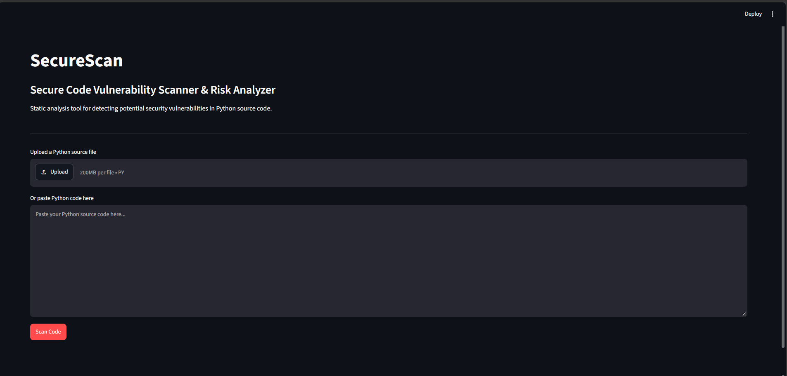
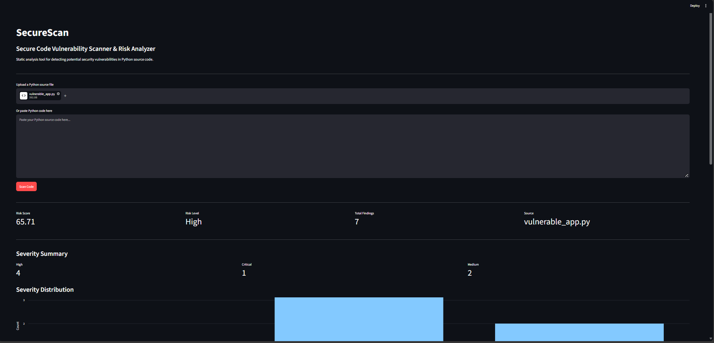
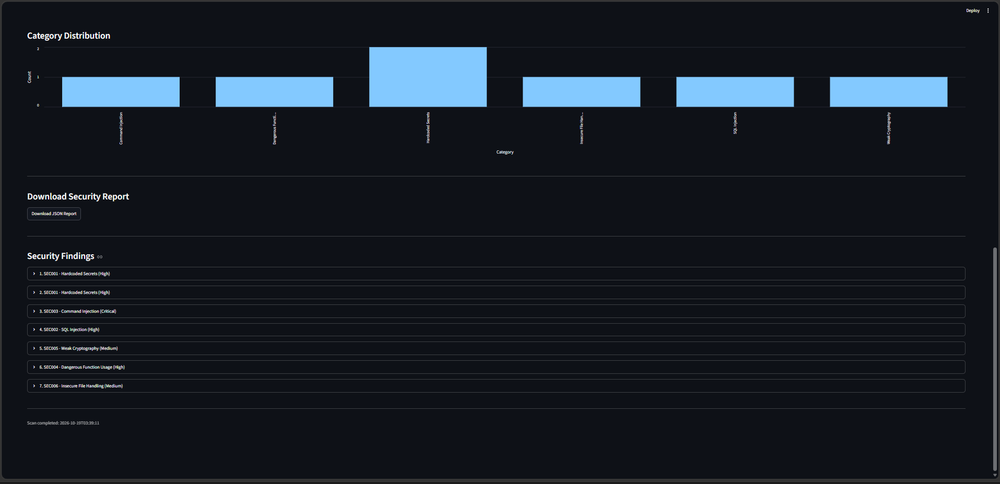
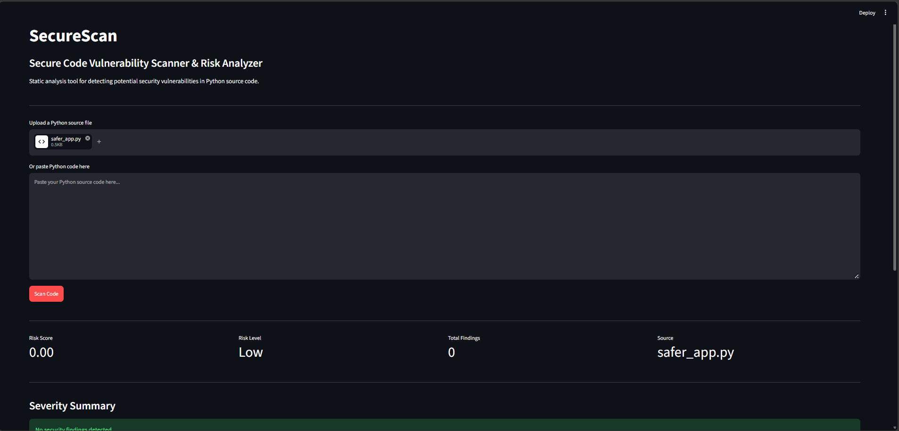

# SecureScan — Secure Code Vulnerability Scanner & Risk Analyzer

SecureScan is a Python-based Static Application Security Testing (SAST) tool designed to analyze Python source code for common security vulnerabilities without executing the analyzed code.

It combines Python AST parsing, pattern analysis, custom security rules, severity classification, risk scoring, and actionable remediation recommendations into an interactive Streamlit dashboard.

---

## Live Demo

Coming soon — Streamlit deployment.

---

## Project Overview

SecureScan analyzes Python source code through the following pipeline:

**Source Code → AST Parsing + Pattern Analysis → Security Rule Engine → Vulnerability Detection → Severity Classification → Risk Analysis → Recommendations → Security Report → Interactive Dashboard**

The scanner is designed to identify selected security weaknesses and help developers understand their potential impact and recommended remediation.

---

## Security Detection Categories

SecureScan currently defines rules for:

1. Hardcoded Secrets
2. SQL Injection
3. Command Injection
4. Dangerous Function Usage
5. Weak Cryptography
6. Insecure File Handling
7. Input Validation Issues
8. Suspicious Security Patterns

---

## How SecureScan Works

The `scan_source()` function follows these main steps:

1. Receives Python source code.
2. Detects selected security vulnerabilities.
3. Classifies detected findings by severity.
4. Calculates the risk score.
5. Determines the risk level.
6. Generates the final security report.

SecureScan performs static analysis and does not execute the analyzed source code.

---

## Risk Classification

SecureScan uses a custom severity-weighted risk score.

| Severity | Weight |
|---|---:|
| Critical | 10 |
| High | 7 |
| Medium | 4 |
| Low | 1 |

Risk levels are classified as:

| Risk Score | Risk Level |
|---:|---|
| 75–100 | Critical |
| 50–74.99 | High |
| 25–49.99 | Medium |
| 0–24.99 | Low |

The risk score is a custom prioritization metric for this project and should not be interpreted as a CVSS score or a complete measurement of application security.

---

## Screenshots

### 1. SecureScan Dashboard



### 2. Vulnerable Code Scan



### 3. Detailed Security Findings



### 4. Safer Code Scan



---

## Technology Stack

| Area | Technology |
|---|---|
| Programming Language | Python |
| Static Analysis | Python AST |
| Pattern Detection | Regular Expressions |
| Security Analysis | Custom SAST Rules |
| Dashboard | Streamlit |
| Data Processing | Pandas |
| Visualization | Plotly |
| Testing | Pytest |
| Version Control | Git / GitHub |
| Environment | Python Virtual Environment |

---

## Requirements

Before running SecureScan, install:

- Python 3.10+
- pip
- Git
- Python virtual-environment support

---

## Installation

### 1. Clone the Repository

```bash
git clone https://github.com/mdsakibhasan-cs/SecureScan.git
cd SecureScan
```

### 2. Create a Virtual Environment

#### Windows

```powershell
python -m venv .venv
.venv\Scripts\Activate.ps1
```

#### Linux / macOS

```bash
python3 -m venv .venv
source .venv/bin/activate
```

### 3. Install Dependencies

```bash
pip install -r requirements.txt
```

---

## Run the Dashboard

```bash
python -m streamlit run app.py
```

Then open the local Streamlit URL shown in the terminal.

---

## Usage

1. Open the SecureScan dashboard.
2. Upload a Python `.py` file or paste Python source code.
3. Click **Scan Code**.
4. Review the overall risk score and risk level.
5. Review severity and vulnerability-category distributions.
6. Inspect individual security findings.
7. Review the recommended remediation steps.
8. Download the generated JSON security report when required.

---

## Reference Samples

SecureScan includes two reference applications for validation.

### Vulnerable Sample

File:

```text
samples/vulnerable_app.py
```

Verified result:

- **Total Findings:** 7
- **Risk Score:** 65.71
- **Risk Level:** High

Detected categories include:

- Hardcoded Secrets
- Command Injection
- SQL Injection
- Weak Cryptography
- Dangerous Function Usage
- Insecure File Handling

### Safer Sample

File:

```text
samples/safer_app.py
```

Verified result:

- **Total Findings:** 0
- **Risk Score:** 0.0
- **Risk Level:** Low

These results are specific to the included reference samples and should not be interpreted as proof of complete vulnerability-detection coverage.

---

## Testing

SecureScan includes an automated Pytest test suite covering:

- Vulnerable source-code detection
- Safer source-code validation
- Empty source input
- Syntax-error handling

Run the tests with:

```bash
pytest
```

### Current Validation

```text
4 passed
```

---

## Security Design

SecureScan follows a static-analysis approach.

The scanner:

- Parses Python source code using AST.
- Uses pattern analysis for selected security indicators.
- Applies predefined security rules.
- Produces structured vulnerability findings.
- Classifies findings by severity.
- Calculates a custom risk score.
- Provides remediation recommendations.
- Generates structured JSON reports.
- Does not execute analyzed source code.

This design avoids executing potentially unsafe source code during scanning.

---

## Project Structure

```text
SecureScan/
│
├── scanner/
│   ├── __init__.py
│   ├── detector.py
│   ├── parser.py
│   ├── reporter.py
│   ├── risk.py
│   ├── rules.py
│   ├── scanner.py
│   └── severity.py
│
├── tests/
│   └── test_scanner.py
│
├── samples/
│   ├── safer_app.py
│   └── vulnerable_app.py
│
├── screenshots/
│   ├── 1.dashboard.png
│   ├── 2.vulnerable-scan.png
│   ├── 3.detailed-findings.png
│   └── 4.safer-scan.png
│
├── reports/
│
├── app.py
├── requirements.txt
├── README.md
├── .gitignore
└── LICENSE
```

---

## Limitations

SecureScan is an educational, research, and portfolio-oriented SAST project.

It is not intended to replace professional security-analysis platforms.

Current limitations include:

- The scanner focuses on selected Python security patterns.
- Static pattern matching can produce false positives.
- Static analysis can miss vulnerabilities.
- Complex application-level data flows are not fully modeled.
- Cross-file analysis is not currently implemented.
- SQL injection detection is pattern-based rather than full data-flow analysis.
- File-handling detection is pattern-based.
- SEC007 and SEC008 are currently defined as security rules but do not yet have active detection logic.
- The risk score is a custom prioritization metric.
- The scanner currently focuses on Python source code.
- A zero-finding result does not guarantee that source code is secure.
- Security findings should be manually reviewed before production use.

---

## Future Improvements

Potential future enhancements include:

- Expanded vulnerability rule coverage
- Advanced data-flow analysis
- Taint analysis
- Cross-file analysis
- Improved SQL injection analysis
- Improved command-injection detection
- Expanded input-validation detection
- CWE mapping
- CVSS-inspired prioritization
- SARIF report generation
- HTML security reports
- PDF security reports
- CI/CD integration
- GitHub Actions security scanning
- Automated pull-request security scanning
- Additional programming-language support
- More comprehensive test coverage
- Improved false-positive reduction
- Configurable security rules
- User-defined security rules

---

## Project Purpose

SecureScan was developed as a practical cybersecurity and software-engineering project to explore:

- Static Application Security Testing
- Secure coding practices
- Python AST analysis
- Vulnerability detection
- Security rule engineering
- Risk prioritization
- Automated software testing
- Security-focused application development
- Interactive security dashboards
- Security report generation

---

## Learning Outcomes

This project demonstrates practical experience with:

- Python application development
- AST-based source-code analysis
- Regular-expression pattern matching
- Security vulnerability detection
- Rule-based security analysis
- Risk scoring
- Streamlit application development
- Data visualization
- Automated testing
- Software project architecture
- Secure software-development concepts
- Git and GitHub workflow

---

## Project Validation

The project was validated using reference source-code samples and automated tests.

### Vulnerable Sample

- **Findings:** 7
- **Risk Score:** 65.71
- **Risk Level:** High

### Safer Sample

- **Findings:** 0
- **Risk Score:** 0.0
- **Risk Level:** Low

### Automated Tests

- **4 passed**

These results are specific to the included reference samples and test cases.

They should not be interpreted as evidence of complete vulnerability-detection coverage.

---

## Disclaimer

SecureScan is provided for educational, research, and portfolio purposes.

The scanner does not guarantee that analyzed software is secure.

A zero-finding result does not mean that an application contains no vulnerabilities.

Detected findings should be reviewed and validated by qualified developers or security professionals.

For production applications, SecureScan should be used as one component of a broader secure software-development and security-testing process.

---

## License

This project is intended to be released under the MIT License.

See the `LICENSE` file for the complete license text.

---

## Author

**MD Sakib Hasan**

Computer Science and Technology  
Nantong University

Areas of interest:

- Cybersecurity
- Secure Software Engineering
- Software Development
- Artificial Intelligence
- Machine Learning
- Static Code Analysis

---

## Project Status

**Completed Portfolio Project**

Core scanner, security rules, vulnerability detection, risk analysis, dashboard, reporting, reference-sample validation, screenshots, and automated testing are implemented.

Current verified test status:

**4 passed**